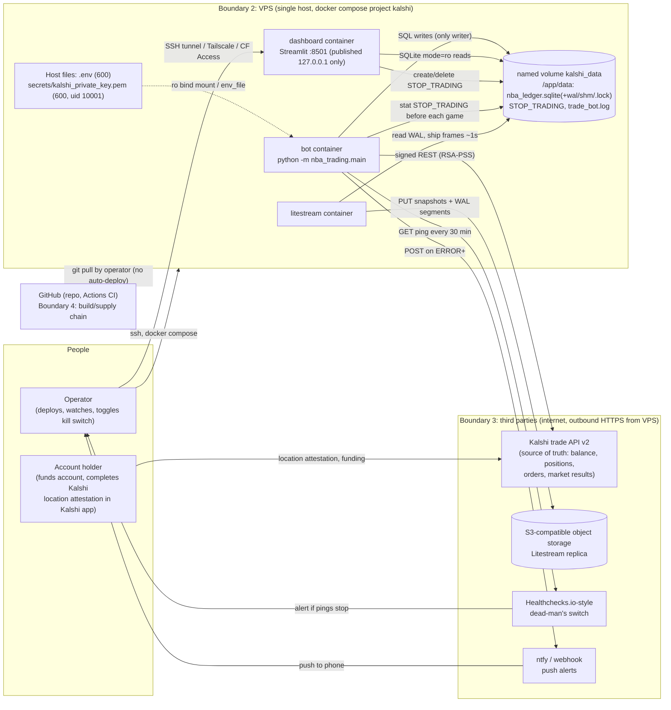
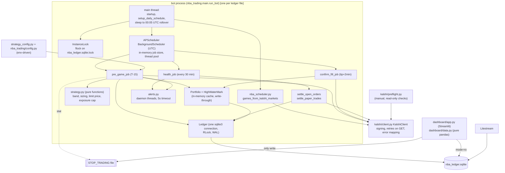
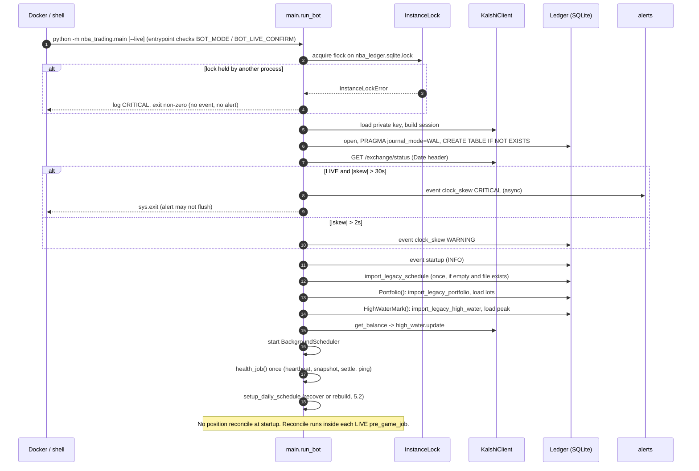
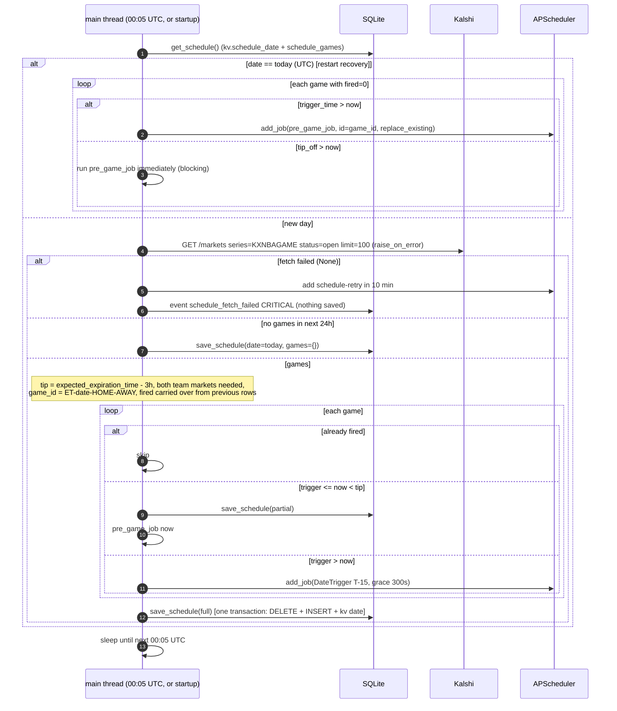
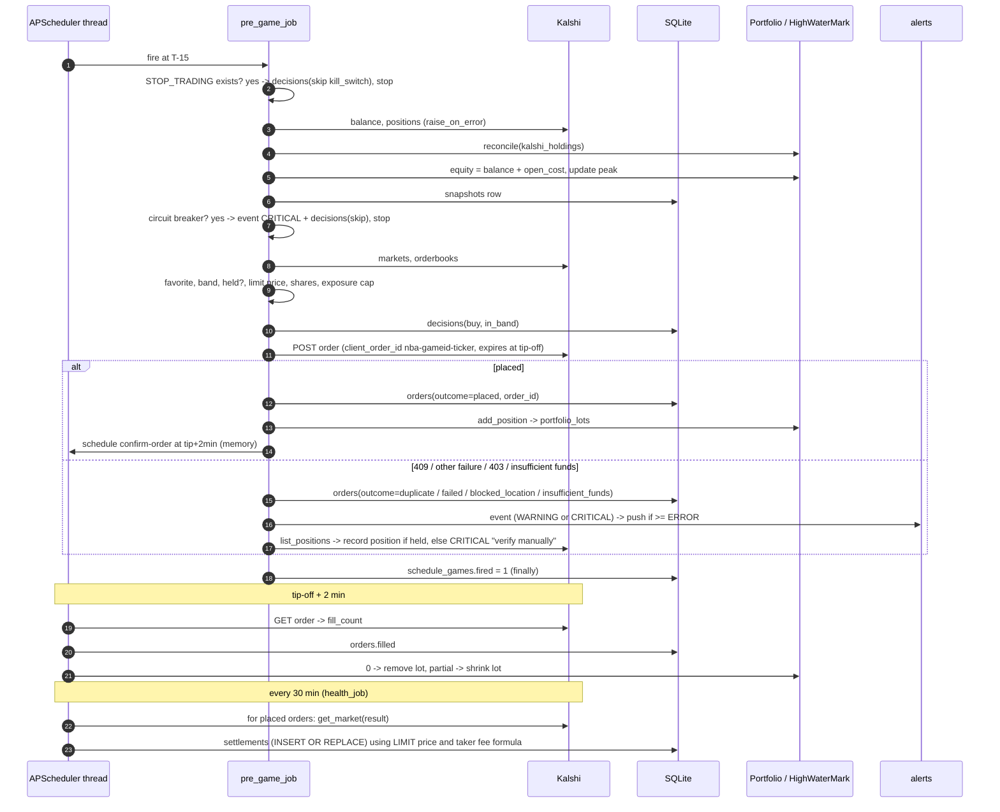
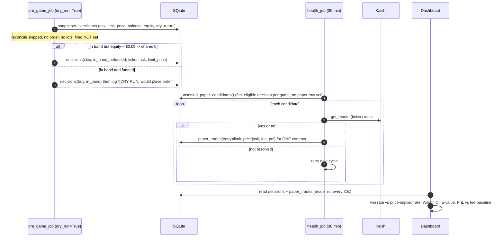
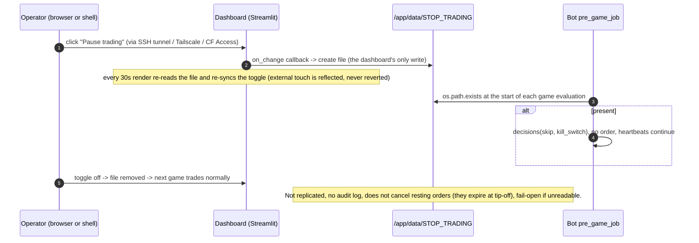
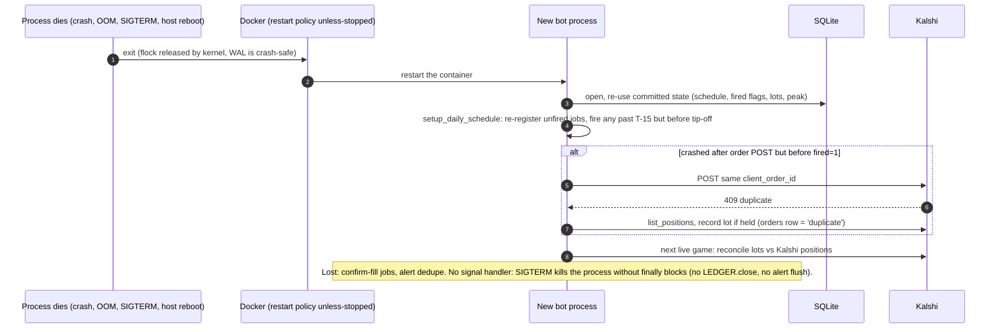
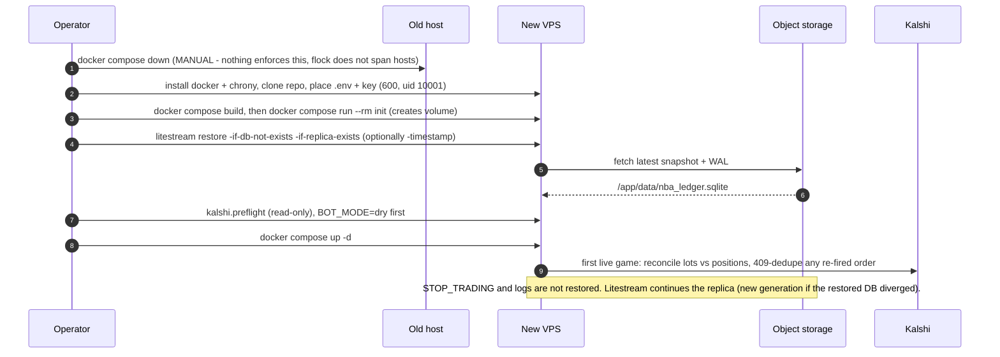

# System architecture: Kalshi NBA favorite bot

Audience: an engineer joining the project. Scope: the deployed trading system
(`nba_trading/`, `kalshi/`, `strategy_config.py`, Docker/Litestream/CI tooling).
Companion docs: [`deployment.md`](deployment.md) (operator runbook), [`architecture.md`](architecture.md)
(older, package-by-package; its `nba_trading` section is stale, see section 8.3).

Basis: git HEAD `73d29b3` plus the uncommitted working tree as read on 2026-10-28. Another engineer is
editing code concurrently, so this document cites files and function/table names, never line numbers.
If something here disagrees with the code, the code wins; please fix this file.

**Evidence tags** used throughout:

| Tag | Meaning |
|---|---|
| **[V]** | Verified by reading the code. |
| **[V/T]** | Verified in code and covered by a unit test in `nba_trading/tests/` or `kalshi/tests/`. |
| **[D]** | Designed but never built or run: Dockerfile, `docker-compose.yml`, `deploy/litestream.yml`, `deploy/entrypoint-bot.sh`, `.github/workflows/ci.yml`. (`.github/` is untracked in git, so CI has never executed on GitHub.) |
| **[A]** | Assumed: depends on external behavior (Kalshi, Litestream, Docker, object storage) that this repo does not test. |

---

## 1. System context



### 1.1 Trust boundaries

| # | Boundary | Trusted side | What crosses it | Control |
|---|---|---|---|---|
| 1 | Operator access path to dashboard | Operator's devices | Dashboard HTTP (can read all ledger data and flip the kill switch) | Port published on `127.0.0.1` only **[D]**; reach via SSH tunnel / Tailscale / Cloudflare Access (no auth in the app itself, see 7.3) |
| 2 | Container <-> container (shared volume) | bot, dashboard, litestream all run as uid 10001 | One SQLite file, one kill-switch file | **Convention, not enforcement**: the dashboard's "read-only" is a SQLite URI flag; the volume is mounted read-write in all three containers (7.3) |
| 3 | VPS <-> internet | VPS | Outbound HTTPS only: Kalshi, S3, Healthchecks, ntfy | Inbound only SSH (provider firewall/ufw) **[D]**. Kalshi requests are signed; alert URLs are redacted in logs **[V]** |
| 4 | Repo/CI <-> production | Operator | Code, image | No auto-deploy; deploy job is `if: false` **[D]**; secrets never in the image (`.dockerignore`) **[D]** |
| 5 | Kalshi account integrity | Account holder | Location attestation, eligibility | Out of band; bot can only detect the failure (HTTP 403 `location_attestation`), not fix it |

Kalshi is the **external source of truth**. The local SQLite file is a cache + audit log + control state; whenever
the two disagree about balance, positions or results, Kalshi wins (see `Portfolio.reconcile`, `settle_*`).

---

## 2. Components



### 2.1 Backend trader (`nba_trading/`)

| Component | File / function | Responsibility |
|---|---|---|
| Entry + supervision | `main.py: run_bot`, `_run_locked`, `_run_loop` | Acquire instance lock, build client + ledger, clock-skew check, legacy import, health job, schedule build, then sleep-loop to daily rollover. Unhandled exception in the loop -> `bot_crash` CRITICAL event, alert flush, `sys.exit(1)` (container restarts). |
| Live gate | `main.py: _confirm_live`; `deploy/entrypoint-bot.sh` | `--live` requires typing `LIVE` or env `BOT_LIVE_CONFIRM=LIVE`; the entrypoint additionally requires `BOT_MODE=live`. Default is dry run. **[V/T] [D]** |
| Schedule build | `main.py: setup_daily_schedule`; `nba_scheduler.py: get_schedule`, `games_from_kalshi_markets` | Derive games from open `KXNBAGAME` markets: tip-off = `expected_expiration_time` minus 3h (both team markets required, 24h look-ahead). Persist schedule, register one T-15 job per unfired game. A failed fetch (`None`) is never persisted as "no games"; retried every 10 min via the `schedule-retry` job. **[V/T]** |
| Pre-game decision | `main.py: pre_game_job` -> `_pre_game_body` | Kill switch -> balance -> (live) reconcile against Kalshi positions -> equity + circuit breaker -> markets/orderbooks -> favorite -> band -> already-held -> limit price -> sizing + exposure cap -> decision row -> (live) order. Every exit path records a `decisions` row (buy or skip + reason). |
| Strategy | `strategy.py` | Pure functions: `get_implied_ask` (100 - best NO bid), `identify_favorite` (higher implied ask; tie -> home), `should_buy` (inclusive band), `compute_shares_to_buy` (floor(equity x fraction / ask)), `compute_limit_price` (ask + buffer, capped at band max), `cap_shares` (cash cap and `MAX_EXPOSURE_PCT` of equity). |
| Circuit breaker / equity | `main.py: _pre_game_body`, `portfolio.py: HighWaterMark` | equity = Kalshi cash balance + locally tracked open cost. Peak persisted in `kv`. `drawdown >= MAX_DRAWDOWN_PCT` (default 25) -> skip with `circuit_breaker:<pct>` and a CRITICAL event. |
| Exposure cap | `strategy.cap_shares` | Total open cost + new order <= `MAX_EXPOSURE_PCT` (default 30) of equity; also never more than cash. |
| Kill switch (read side) | `_pre_game_body` (`os.path.exists(config.KILL_SWITCH_FILE)`) | First check of every evaluation; records `skip kill_switch`. |
| Reconcile | `Portfolio.reconcile`, `main._kalshi_holdings` | Live only, inside `pre_game_job`: drop local tickers Kalshi no longer holds (unless newest lot < 30 min old), overwrite last-lot qty if Kalshi's count differs. A failed positions fetch -> skip `reconcile_failed` (fail closed). |
| Order handling | `_pre_game_body`, `_reconcile_ambiguous_order`, `_client_order_id` | Deterministic `client_order_id = nba-<game_id>-<ticker>`; GTC limit order with `expiration_time` = tip-off. Outcomes: `placed`, `insufficient_funds`, `blocked_location`, `duplicate`, `failed`. No automatic retry of any failed placement. |
| Fill check | `confirm_fill_job` | Tip-off + 2 min: read order, store `orders.filled`; 0 fills -> remove lot; partial -> shrink lot; unreadable count -> leave as is, CRITICAL log. |
| Health + settlement | `health_job`, `settle_open_orders`, `settle_paper_trades` | Every 30 min (and once synchronously at startup): balance, snapshot, settle finished games, write `heartbeat` event, ping Healthchecks (`/fail` if balance unreadable or on exception). |
| Paper trades | `Ledger.unsettled_paper_candidates`, `record_paper_trade`, `settle_paper_trades` | In-band **dry-run** decisions (`action='buy'` or reason `in_band_unfunded` / `in_band_capped_to_zero`) become one-contract hypothetical trades at `limit_price` (fallback `ask_cents`), settled from the market `result`. First eligible decision per `game_id` only. |
| Alerts | `alerts.py: notify`, `ping_healthcheck`, `flush` | Push to ntfy and/or webhook at `>= ALERT_MIN_LEVEL` (effective default **ERROR**), per-`kind` 15-min dedupe held in memory, daemon threads, 5 s timeout, all exceptions swallowed, URLs redacted. |
| Ledger layer | `ledger.py: Ledger`, `InstanceLock`, fee/PnL helpers | Schema, all SQL, transactions, legacy JSON import, single-instance flock. |
| Config | `strategy_config.py`, `nba_trading/config.py`, `kalshi/config.py` | Env-driven: band 91-99, fraction 0.10, buffer 0, drawdown 25, exposure 30; paths; alert URLs; misfire graces; clock-skew thresholds (warn 2s, refuse live 30s). `kalshi/config.py` raises at import if `API_KEY_ID`/`PRIVATE_KEY_PATH` are missing. |

Scheduler jobs (all APScheduler 3.11.2, UTC, default in-memory store and thread pool, `coalesce=True`):

| Job id | Trigger | Misfire grace | Persisted? |
|---|---|---|---|
| `<game_id>` (`pre_game_job`) | DateTrigger at tip-off - 15 min | 300 s | No. Rebuilt on start from `schedule_games` + `kv` |
| `confirm-<order_id>` | DateTrigger at tip-off + 2 min | 3600 s | **No, and not rebuilt** (see 8.2 G5) |
| `health` | every 30 min (+ one direct call at startup) | 300 s | No, re-registered each start |
| `schedule-retry` | DateTrigger now + 10 min after a failed fetch | 600 s | No; the next rollover/restart rebuilds |
| (main thread) | sleeps to 00:05 UTC, then `setup_daily_schedule` | n/a | n/a |

### 2.2 Kalshi client (`kalshi/client.py`, `kalshi/preflight.py`)

| Item | Behavior |
|---|---|
| Auth | RSA-PSS/SHA-256 signature over `timestamp + METHOD + /trade-api/v2/<path>`, headers `KALSHI-ACCESS-*`. Key loaded once at construction (no passphrase). **[V]** |
| Retries | GET only: 3 retries on 429/500/502/503/504 with backoff and `Retry-After`. POST is **never** retried (double-buy risk). **[V/T]** |
| Error mapping | Reads mostly swallow errors to `None`/`[]` (`get_balance`, `get_orderbook`, `get_market`, `get_order_status`, and `fetch_nba_markets`/`list_positions` unless `raise_on_error=True`). Callers that act on emptiness must pass `raise_on_error=True` (`get_schedule`, `_kalshi_holdings`). `place_limit_order` returns sentinels `INSUFFICIENT_FUNDS`, `LOCATION_ATTESTATION` (HTTP 403), `DUPLICATE_ORDER` (HTTP 409) or `None`. |
| Orders | V2 endpoint `POST /portfolio/events/orders`, YES-leg bid, `time_in_force=good_till_canceled`, `expiration_time`, `self_trade_prevention_type=taker_at_cross`. |
| Clock | `clock_skew_seconds` from the HTTP `Date` header of `/exchange/status` (about +-1 s accuracy). |
| Pagination | `fetch_nba_markets` sends `limit=100` and does not follow the cursor (see 8.2 G6). |
| Preflight | `python -m kalshi.preflight`: read-only checks of auth, balance units, orderbook shape, positions field. `--place-test-order` refuses unless `KALSHI_ENV=demo`. Manual tool, not part of the runtime. |

### 2.3 Frontend dashboard (`nba_trading/dashboard/`)

* Streamlit single page (`app.py`) + pure data layer (`data.py`, unit-tested without Streamlit).
* The page body is one `@st.fragment(run_every=30)`: every 30 s **per open browser session** it opens a fresh
  read-only connection (`sqlite3.connect("file:<path>?mode=ro", uri=True)`), runs `SELECT *` on six tables, closes it.
* **Reads:** `decisions, orders, settlements, snapshots, events, paper_trades` only. It never reads `kv`,
  `portfolio_lots` or `schedule_games`. It also `stat`s the kill-switch file on every render.
* **The one write:** `data.set_kill_switch(path, on)` creates (`"paused from dashboard\n"`) or removes
  `STOP_TRADING`. It runs only from the toggle's `on_change` callback, never on a refresh; the toggle state is
  re-synced from the file on every render so a shell-side `touch` shows up and is never reverted. **[V/T]**
* Tabs: **Overview** (settled count, win rate, net PnL, equity line), **Live edge vs pricing** (paper or live source,
  Wilson interval, exact one-sided p-value vs price-implied win rate, cumulative PnL vs fee baseline),
  **Decisions** (skip-reason bar chart + table), **Trades** (paper trades + orders with a derived status: open, settled, unfilled, or the order outcome), **Health** (non-heartbeat events, last 200).
* Status strip: heartbeat age (`running` < 45 min, else `STALE`), kill-switch state + toggle, equity, cash/open,
  drawdown, mode of the last decision, count of all-time CRITICAL events.
* A ledger written by an older bot without `paper_trades` is tolerated; any other missing table raises.

### 2.4 CI and deploy tooling **[D]**

| Piece | What it does |
|---|---|
| `Dockerfile` | One image (python:3.13-slim, uid/gid 10001, no secrets, `COPY . .` filtered by `.dockerignore`); default CMD = dashboard; compose overrides the bot entrypoint. |
| `docker-compose.yml` | `init` (root one-shot, `chown -R 10001:10001 /app/data`), `bot` (working_dir `/app/data`, env_file `.env`, key bind-mounted ro, heartbeat-age healthcheck), `dashboard` (127.0.0.1:8501, no env_file), `litestream` (image `litestream/litestream:0.3.13`). All: `restart: unless-stopped`, `init: true`, `no-new-privileges`, `cap_drop: ALL`, log rotation 10m x 5. |
| `deploy/litestream.yml` | Replicate `/app/data/nba_ledger.sqlite` to S3-compatible storage; `sync-interval 1s`, `snapshot-interval 24h`, `retention 168h`. |
| `deploy/entrypoint-bot.sh` | `BOT_MODE=dry` (default) or `live` (needs `BOT_LIVE_CONFIRM=LIVE`); anything else exits 64. |
| `.github/workflows/ci.yml` | `test` (pytest on Python 3.13 with dummy Kalshi env), `docker-build` (build, assert no `.env`/state/`.pem`/`.sqlite` in image, import smoke test, `docker compose config -q`), `deploy` (disabled stub, manual only). `permissions: contents: read`. |

### 2.5 Out of scope here

`sportsbook_sourced/` (paper-only sportsbook-anchored scanner, own `data/sportsbook_sourced.sqlite`),
`agent_trader/` (frozen LLM experiment), `misprice_discovery/` (offline research and backtests, e.g.
`edge_validation.py`; some scripts call public Kalshi/NBA endpoints to build CSV datasets). None of them is
deployed by `docker-compose.yml` and none touches `nba_ledger.sqlite`.

---

## 3. Data stores

### 3.1 Inventory

| Store | Holds | Writer | Readers | Location | Durability | Recovery path |
|---|---|---|---|---|---|---|
| **`nba_ledger.sqlite`** (WAL mode) | Everything durable: audit tables, positions, drawdown peak, schedule + fired flags, import markers (3.2) | **bot process only** (one connection, RLock). Litestream also touches it at the SQLite level **[A]** | bot; dashboard (`mode=ro`); Docker healthcheck (`mode=ro`); Litestream | Named volume `kalshi_data` -> `/app/data` on the VPS. Local dev: `data/nba_ledger.sqlite` | Local disk + WAL; replicated by Litestream. Commit durability is SQLite's default `synchronous` (not tuned) | `litestream restore` from bucket (5.7). Positions/peak/schedule come back with it; Kalshi reconciles positions on the next live game |
| `nba_ledger.sqlite-wal` / `-shm` | Un-checkpointed committed pages | SQLite | same | beside the DB | Part of the DB: **never copy or back up the `.sqlite` file alone** (the main file can be nearly empty while data sits in the WAL) | Litestream handles; manual copies must include `-wal` |
| `nba_ledger.sqlite.lock` | PID text; flock target | bot (`InstanceLock`) | bot | beside the DB | Ephemeral; kernel drops the lock when the process dies, so no stale locks | Safe to delete only while no bot runs (deleting it under a running bot defeats the lock) |
| **Litestream replica** | Snapshots (every 24h) + WAL segments (about 1 s cadence) | litestream container | operator via `litestream restore` | S3-compatible bucket, prefix `LITESTREAM_PATH` | Provider durability. Retention 7 days **[D][A]** | It is the recovery path |
| **`STOP_TRADING`** (kill switch) | Presence = pause new orders | dashboard (create/delete), operator shell | bot (`os.path.exists`), dashboard | same volume, `/app/data/STOP_TRADING`. Local dev default: repo root | Plain file; **not replicated**; survives restart, lost with the volume | Re-create by hand. A lost file silently means "trading allowed" (fail-open) |
| **`trade_bot.log`** | Human log, rotating 5 MB x 3 | bot (`RotatingFileHandler`, path relative to cwd) | operator | `/app/data/trade_bot.log` (compose `working_dir`); local dev: repo root | Best effort; not replicated; lost with the volume | Docker's json-file copy of stdout (10 MB x 5) survives volume loss but not host loss |
| Container stdout | Same log lines | Docker json-file driver | `docker compose logs` | VPS `/var/lib/docker` | Rotated, host-local | none |
| **Legacy JSON** `schedule_data.json`, `portfolio_data.json`, `high_water_mark.json` | Pre-SQLite state | nobody (never written any more) | bot, **once**, at startup (`import_legacy_*`) | Paths from env (compose points at `/app/data/*.json`, absent on a fresh server) | n/a | Read-only input; never modified or deleted |
| **Kalshi (external truth)** | Cash balance, positions, orders, fills, market results, true tip-off proxy (`expected_expiration_time`) | Kalshi | bot via `KalshiClient` | Kalshi | Kalshi's | Reconcile/settle jobs re-derive local state |
| `.env`, `secrets/kalshi_private_key.pem` | Secrets + config | operator | compose, bot | VPS host filesystem (mode 600) | Not backed up by design | Password manager; reissue key at Kalshi |
| **In-memory only** (3.3) | Scheduler jobs, alert dedupe, Portfolio/HighWaterMark caches, `main.LEDGER` | bot | bot | bot process | Lost on restart | Rebuilt from SQLite + Kalshi |

### 3.2 SQLite schema (from `ledger.SCHEMA`) and ownership

| Table | Key / constraints | Columns (abridged) | Written by | Semantics |
|---|---|---|---|---|
| `decisions` | `id` PK AUTOINCREMENT; `CHECK action IN ('buy','skip')`; `dry_run NOT NULL` | `ts, game_id, home, away, tip_off_utc, ticker, ask_cents, action, reason, shares, limit_price, balance_cents, equity_cents, band_min, band_max, fraction, dry_run` | `_decide` (`pre_game_job`) | One row per game **evaluation** (restarts can produce several for one game). Append-only. Skip `reason` values: `kill_switch, balance_fetch_failed, reconcile_failed, circuit_breaker:<pct>, markets_not_found, no_orderbook_data, no_ask_price, outside_band:<ask>, already_have_position, in_band_unfunded, in_band_capped_to_zero`. `buy` reason is `in_band`. |
| `orders` | `id` PK AUTOINCREMENT; `decision_id` -> `decisions(id)` (nullable); index on `order_id` (non-unique) | `ts, ticker, client_order_id, order_id, count, limit_price, outcome, filled` | `_order_row` (insert); `set_filled` (update `filled`) | One row per live order **attempt**. `outcome` in `placed, insufficient_funds, blocked_location, duplicate, failed` (no CHECK). `filled` NULL until known. |
| `settlements` | `order_pk` PK -> `orders(id)` | `ts, result, filled, fee_cents, pnl_cents` | `settle_open_orders` -> `record_settlement` (`INSERT OR REPLACE`) | Realized PnL for `placed` orders once the market has `result` yes/no. |
| `paper_trades` | `decision_id` PK -> `decisions(id)` | `ts, ticker, entry_cents, result, fee_cents, pnl_cents` | `settle_paper_trades` -> `record_paper_trade` (`INSERT OR REPLACE`) | One contract at `entry_cents`, settled vs the real result. |
| `snapshots` | none | `ts, balance_cents, open_cost_cents, equity_cents, peak_cents, drawdown_pct` | `_snapshot` (pre-game body, `health_job`) | Time series for the equity chart. |
| `events` | none | `ts, level, kind, message` | `_event` | Operator-visible log + `heartbeat` rows (INFO, every 30 min). Kinds: `startup, heartbeat, balance_fetch_failed, reconcile_failed, circuit_breaker, insufficient_funds, location_attestation, duplicate_order, order_failed, schedule_fetch_failed, health_job_failed, bot_crash, clock_skew`. |
| `kv` | `key` PK | `value TEXT` | `set_kv`, `import_legacy_*` | Keys: `high_water_peak_cents`, `schedule_date`, `legacy_import:{portfolio,high_water,schedule}` (value `imported:<ts>`, `skipped:no-file`, or `skipped:not-empty`). |
| `portfolio_lots` | `id` PK AUTOINCREMENT | `ticker, price, qty, time` | `Portfolio._save_to_disk` -> `replace_portfolio_lots` | Open tax lots. Rewritten wholesale (DELETE + INSERT) on every mutation. `price` is the **limit price**, not the average fill. |
| `schedule_games` | `seq` PK; `game_id` UNIQUE | `home_team, away_team, tip_off_utc, trigger_time_utc, fired` | `replace_schedule`, `mark_game_fired`, legacy import | Current schedule window. `schedule_date` lives in `kv`. `game_id = <ET date>-<HOME>-<AWAY>`. |

Schema notes **[V]**: `PRAGMA foreign_keys` is never enabled, so the declared `REFERENCES` are documentation only;
there is no schema-version table, so changes are `CREATE TABLE IF NOT EXISTS`-only (new tables are safe, new columns
are not migrated); `busy_timeout` is left at Python's default (5 s connect timeout).
Litestream is expected to add its own `_litestream_seq` / `_litestream_lock` tables **[A]**.

### 3.3 In-memory state lost on restart, and how it is rebuilt

| State | Where | Rebuilt by |
|---|---|---|
| Pending `pre_game_job`s | APScheduler memory store | `setup_daily_schedule`: if `kv.schedule_date` == today (UTC) re-register every `fired=0` game whose trigger is in the future; fire immediately if past T-15 but before tip-off; otherwise a fresh day rebuilds from Kalshi markets. |
| Pending `confirm-<order_id>` jobs | APScheduler memory store | **Not rebuilt.** Partial coverage: `settle_open_orders` fetches the fill count for `placed` orders with `filled IS NULL`, and live `reconcile` corrects lots before the next game. |
| `health` job | APScheduler | re-registered at startup. |
| `schedule-retry` job | APScheduler | the restart itself re-runs `setup_daily_schedule`. |
| Alert dedupe (`_last_sent`) | `alerts.py` module dict | Lost: a restart can re-send an alert kind inside the 15-min window. |
| Portfolio positions, peak | Python dict / int, write-through to SQLite | Loaded from `portfolio_lots` / `kv` in the constructors. A failed save leaves memory ahead of disk until restart. |
| `main.LEDGER` | module global | Set in `_run_locked`, cleared on exit. |

---

## 4. Write policies

### 4.1 Principles

1. **One logical writer.** The bot process owns every mutation of the SQLite file. The dashboard has no write path to it.
   The only cross-process write besides Litestream's is the dashboard's kill-switch file. **[V/T]**
2. **State changes are SQLite transactions.** Multi-row writes use `with self._lock, self.conn:` (commit on success,
   rollback on exception). Single-row audit inserts use `execute` + `commit()`. **[V/T]**
3. **Kalshi is authoritative; local state is corrected toward it**, never the reverse. **[V]**
4. **Observability must never block trading.** Ledger and alert failures are logged and swallowed on the order path. **[V/T]** (exceptions listed in 4.5)
5. **No automatic retry of anything that may have moved money.** Ambiguity -> reconcile against Kalshi positions,
   else CRITICAL log + human. **[V/T]**
6. **Append-only audit.** No code path updates or deletes `decisions`, `orders` (except `filled`), `settlements`
   (except replace-on-resettle), `paper_trades`, `snapshots`, `events`. **[V]**

### 4.2 Per-store write matrix

| Store / table | Who may write | When | Atomicity | Idempotency / keys | On write failure |
|---|---|---|---|---|---|
| `decisions` | bot (`pre_game_job` thread, or main thread on immediate-fire) | At every exit of `_pre_game_body` (skip) and just before placing an order (buy) | One INSERT + commit | None: re-evaluation inserts another row; paper-trade logic dedupes by `MIN(id)` per `game_id` | `_decide` logs and returns `None`; trading continues; the order row will carry `decision_id = NULL` |
| `orders` | bot, order path (`_order_row`) and `set_filled` | Insert **after** the Kalshi call returns (any outcome); `filled` updated by `confirm_fill_job` and `settle_open_orders` | INSERT/UPDATE + commit | Row-level none; real dedupe is Kalshi's `client_order_id` (`nba-<game_id>-<ticker>`). No UNIQUE constraint on `client_order_id` locally | Insert failure: logged, swallowed (order already sent). `set_filled` failure is **not** guarded (see 4.5) |
| `settlements` | bot, `health_job` thread | When Kalshi market `result` in {yes,no} and fill count known | INSERT OR REPLACE + commit | PK `order_pk`: re-running overwrites the same row | Exception caught per order in `settle_open_orders`; retried next cycle |
| `paper_trades` | bot, `health_job` thread | When the market `result` is known, for dry-run in-band decisions | INSERT OR REPLACE + commit | PK `decision_id`; candidate query excludes already-settled and non-first decisions | Caught per row; retried next cycle |
| `snapshots` | bot | Each pre-game evaluation (after equity calc) and each health job | INSERT + commit | none (can duplicate; harmless) | `_snapshot` swallows |
| `events` | bot (`_event`) | On errors/warnings/heartbeat | INSERT + commit | none | Swallowed; the alert is still attempted (alerts run outside the ledger try/except) |
| `kv` (`high_water_peak_cents`) | bot (`HighWaterMark.update` -> `set_peak_cents`) | When equity exceeds the stored peak | One transaction | `INSERT OR REPLACE` | `HighWaterMark._save_to_disk` logs; in-memory peak is kept |
| `kv` (`schedule_date`, `legacy_import:*`) | bot | Schedule save; first start per legacy file | Same transaction as the data it describes | `INSERT OR REPLACE` | see schedule / import rows |
| `portfolio_lots` | bot via `Portfolio` (`add_position`, `remove_position`, `update_position_qty`, `reconcile`) | After a successful order, on fill check, on live reconcile | Whole-table replace in **one transaction** (all-or-nothing) **[V/T]** | Full-state overwrite, so retrying is idempotent | `_save_to_disk` logs ERROR and continues; memory ahead of disk until restart |
| `schedule_games` | bot (`save_schedule`, `mark_game_fired`) | Daily build, immediate-fire path, and in `finally` of every **live** `pre_game_job` | Replace is one transaction; fired flag is a single UPDATE | `game_id` UNIQUE; `fired` is monotonic: `_replace_schedule_locked` re-applies any already-set flag, so a save never un-sets it **[V/T]** | **Not guarded**: exception propagates (kills the main loop if raised in `setup_daily_schedule`; in a job thread it is logged by APScheduler) |
| Legacy import | bot, startup | Only if marker absent AND target empty AND file exists | Data + marker in one transaction | Marker prevents re-import, including after positions legitimately go to zero **[V/T]** | Logged, marker not set, retried next start |
| `STOP_TRADING` | dashboard toggle; operator via `docker compose exec` / shell | On click / by hand | `open(path,"w")` or `os.remove` (not atomic, but a 1-line file whose existence is the signal) | Idempotent | Exception in the Streamlit callback; state unchanged |
| `trade_bot.log` | bot logging | continuously | append; rotating 5 MB x 3 | n/a | logging errors are swallowed by `logging` |
| Replica bucket | litestream only | ~1 s | Object PUTs | Generations/indexes | Litestream logs errors and retries **[A]** |

### 4.3 Concurrency model

| Mechanism | Detail |
|---|---|
| **One bot per database** | `InstanceLock`: `fcntl.flock(LOCK_EX\|LOCK_NB)` on `<db>.lock`, taken before anything else in `run_bot`; the OS drops it on process death. Second instance logs CRITICAL and `sys.exit`s non-zero without touching state. **[V/T]** Scope: **one host / one filesystem only** (8.2 G7). |
| **One SQLite connection** | `sqlite3.connect(..., check_same_thread=False)`, `row_factory=Row`, `PRAGMA journal_mode=WAL`. Every access goes through a single `threading.RLock`, so scheduler worker threads and the main thread are serialized at the SQL level. **[V/T]** (`test_ledger_is_usable_from_worker_threads`) |
| **WAL** | Lets the dashboard, the Docker healthcheck and Litestream read while the bot writes; readers never block the writer. Cross-container WAL works because all containers share one kernel and one local volume **[A]**. |
| **Thread safety above SQL** | `Portfolio` and `HighWaterMark` have **no lock**; `pre_game_job`s for games with the same tip-off run on separate pool threads (default 10 workers) and read-modify-write the same dict. The exposure-cap check is therefore not atomic across concurrent games (8.2 G2). |
| **Idempotent ordering** | `client_order_id` is a pure function of game and ticker; the job is re-fired after any crash before `fired=1`; Kalshi answers 409 and the bot reconciles. **[V/T]** (`test_duplicate_order_409_reconciles_instead_of_retrying`). Kalshi's dedupe window is **[A]**. |
| **Schedule idempotency** | `setup_daily_schedule` is safe to call repeatedly: job ids are `game_id` with `replace_existing=True`; fired flags carry across rebuilds; `game_id` uses the **Eastern** date so it is stable across the UTC midnight rebuild. **[V/T]** |
| **Misfire handling** | Grace times in `config.py` (300 / 3600 / 300 / 600 s) replace APScheduler's 1 s default. A job delayed beyond grace is dropped without an event or alert (8.2 G9: now reported via the scheduler listener). |
| **Dashboard** | New connection per refresh, `mode=ro`; cannot take a write lock. Reading a WAL database read-only still needs the `-shm` file, which works because the volume is writable. |

### 4.4 Ordering rules (live buy path) **[V]**

```
kill-switch stat
  -> get_balance (None => skip, event)
  -> reconcile against Kalshi positions (live; failure => skip)      [portfolio_lots tx]
  -> equity = balance + open_cost; HighWaterMark.update              [kv tx if new peak]
  -> snapshots row
  -> circuit breaker check
  -> markets, orderbooks, favorite, band, already-held, sizing, caps
  -> decisions row (action='buy')                                    <- BEFORE the order
  -> place_limit_order  (Kalshi; idempotent on client_order_id)
  -> orders row (outcome)                                            <- AFTER the order, only if Kalshi answered
  -> portfolio_lots (add_position)                                   <- only on outcome 'placed'
  -> schedule confirm-<order_id> (in memory)
  -> finally: schedule_games.fired = 1                               <- LAST (live only; dry runs never mark fired)
```

Rules this ordering implies: a `decisions` row exists for every order; an order can exist at Kalshi without an
`orders` row if the process dies between the POST and the insert (recovered by re-fire -> 409 -> reconcile, but see
8.2 G4); `fired` is set last so a crash re-fires rather than skips.

### 4.5 When a write fails: what is and is not protected

| Write | Failure handling | Verdict |
|---|---|---|
| `decisions`, `orders` (insert), `snapshots`, `events` | try/except, log, continue | Protected **[V/T]** (`test_ledger_write_failure_never_blocks_trading`) |
| `alerts.notify` / `ping_healthcheck` | daemon thread, 5 s timeout, never raises; called outside the ledger try/except so a ledger failure cannot suppress it | Protected **[V/T]** (`test_alert_failure_cannot_break_event_recording`) |
| `portfolio_lots`, `kv` peak | try/except, ERROR log; in-memory value stays authoritative until restart | Protected, but disk can silently lag memory |
| `orders.filled` (`LEDGER.set_filled` in `confirm_fill_job`) | **No try/except**; it precedes the portfolio update, so a ledger error skips removing/shrinking the lot | Not protected; self-heals at next live reconcile |
| `schedule_games.fired` (`mark_game_fired` in `pre_game_job`'s `finally`) | **No try/except**; exception escapes the job after the order has gone out | Not protected for the job (trading already done); on restart the game re-fires and is deduped by Kalshi |
| `save_schedule` in `setup_daily_schedule` | **No try/except**; propagates to the main loop -> `bot_crash` -> restart | Fails loud (crash-restart loop if the DB stays broken) |
| Startup (`Ledger()` constructor, schema) | Unhandled -> process exits | Fails loud |

SQLite error semantics: the single-statement helpers call `commit()` but never `rollback()`; a failed statement is
not applied, and the connection continues to be used. Disk-full would make the writes above fail repeatedly; there is
no dedicated disk-space alert.

### 4.6 Dashboard access policy

* DB: `mode=ro` URI **[V/T]** (`test_connection_is_read_only`). Enforcement is by SQLite flag only; the container has
  a read-write mount and the same uid as the bot (7.3).
* Filesystem: exactly one write, the kill-switch file, from the toggle callback only **[V/T]**.
  The toggle does not write to the ledger, so **no audit record of who toggled when** exists (the bot only records
  `skip kill_switch` for games it evaluates while the file is present).

### 4.7 Retention and growth

All tables are append-only with **no pruning**. Row rate is small (about 48 `events` + about 48 `snapshots` per day
plus a handful of `decisions`), so growth is not a near-term problem, but the dashboard does `SELECT *` on six tables
every 30 s per open session, so very old ledgers will slow it. `trade_bot.log` rotates at 5 MB x 3; Docker stdout at
10 MB x 5. Replica retention is 7 days (4.8). The dashboard's CRITICAL banner counts **all-time** CRITICAL events
and never clears.

### 4.8 Litestream: what is and is not guaranteed **[D][A]**

Config (`deploy/litestream.yml`): `sync-interval: 1s`, `snapshot-interval: 24h`, `retention: 168h`, single S3
replica. Never built or run in this project.

| Question | Honest answer |
|---|---|
| Is replication synchronous? | **No.** SQLite acknowledges a commit locally; Litestream ships WAL frames afterwards. |
| Expected data loss on host/disk loss (RPO) | Typically the last ~1 s of commits plus upload latency. **Unbounded** if the bucket was unreachable for a while before the loss (Litestream buffers on the same disk it is protecting). Not zero, not measured. |
| Can a restore be inconsistent? | A restore point is a transaction boundary (WAL frames are replayed whole), so tables are mutually consistent with each other. It may be **behind Kalshi**: e.g. an order placed and `fired=1` set in the last second can be missing. The design covers that case with deterministic `client_order_id` + reconcile; it is not tested end to end. |
| Point-in-time recovery window | About 7 days (snapshots and WAL older than `retention` are deleted). Daily snapshot bounds replay length to under 24 h of WAL. |
| Automated restore verification | None configured. The operator is told to restore to a scratch file monthly (`docs/deployment.md` section 8); no job does it. |
| Replication failure alerts | **None.** Litestream is not wired to Healthchecks/ntfy; failures are visible only in `docker compose logs litestream`. The bot's heartbeat says nothing about replication. |
| Two writers to one replica path | Not prevented. A restore onto a new host while the old bot/Litestream still runs would fork the replica (see 5.7). |
| What is **not** replicated | `STOP_TRADING`, `trade_bot.log`, `.env`, the key, Docker state. |
| DB file copy | Never copy `nba_ledger.sqlite` without `-wal`. |

---

## 5. Key flows

### 5.1 Startup **[V/T unless noted]**



### 5.2 Daily schedule build and rollover



### 5.3 Live path: T-15 decision -> order -> fill check -> settlement



### 5.4 Dry run: decision -> paper trade -> paper settlement (current production mode)



Caveat: paper trades assume a fill at the limit price; a real resting order may not fill. Games skipped before a
ticker is known (kill switch, balance failure, markets not found) produce no paper trade.

### 5.5 Kill-switch toggle



### 5.6 Crash and restart recovery



Detection: clean crash -> `bot_crash` CRITICAL (alert + `sys.exit(1)`); hard kill -> heartbeat gap -> Healthchecks
alarm after period + grace (30 + 20 min per runbook); Docker `unhealthy` after the heartbeat is > 50 min old.

### 5.7 Restore onto a fresh server **[D]**



---

## 6. Failure modes

| Failure | Detection | System behavior | Operator action |
|---|---|---|---|
| **Bot process crash** (unhandled error in main loop) | `bot_crash` CRITICAL event + push; Docker restart; heartbeat gap -> Healthchecks | `scheduler.shutdown`, `alerts.flush`, exit 1; compose restarts it; state recovered from SQLite | Read `docker compose logs bot`; fix cause if it repeats |
| **Bot killed hard / host reboot** | No alert from the bot; Healthchecks pings stop; dashboard `STALE` after 45 min; Docker `unhealthy` (label only) | Restart policy brings it back; unfired jobs re-registered; games past T-15 but pre-tip fire at once | Check after Healthchecks alert; `docker compose ps` |
| **Bot hung** (process alive, no jobs) | Same as above: heartbeat stops | `restart: unless-stopped` does **not** restart an unhealthy container | `docker compose restart bot` |
| **Kalshi API down / 5xx / timeouts** | `balance_fetch_failed` (ERROR event, push), Healthchecks `/fail`, dashboard events | GETs retried 3x. Pre-game: skip (`balance_fetch_failed`, `reconcile_failed`, `no_orderbook_data`, `markets_not_found`) and, in live, the game is still marked fired, so there is **no later retry** for that game. Settlement waits and retries every 30 min. Schedule build: `schedule-retry` every 10 min. Heartbeat is still written with message `degraded` | Wait; confirm account state in the Kalshi app |
| **Order POST ambiguous (timeout / 5xx)** | `order_failed` CRITICAL (push) | No retry; `_reconcile_ambiguous_order` records the position if Kalshi shows it, else CRITICAL "verify manually" | Check Kalshi orders/positions; a resting order may exist until tip-off |
| **Location attestation 403** | `location_attestation` CRITICAL event + push; `orders.outcome=blocked_location`; Kalshi order response logged CRITICAL | Order not retried, game still marked fired. Every later game fails the same way until fixed (alert dedupes to one per 15 min) | Account holder re-verifies location in the Kalshi app/site. Bot cannot fix this |
| **Insufficient funds** | WARNING event (below default push level), `orders.outcome=insufficient_funds` | No retry. Note: current dry-run account sizes to 0 shares and never reaches the order call | Fund account |
| **DB write fails** (disk full, I/O error, lock timeout) | ERROR/exception lines in log; some paths silent in the dashboard | Audit writes dropped, trading continues (4.5). Unguarded writes (`set_filled`, `mark_game_fired`, `save_schedule`) raise: job error or crash-restart loop | Free disk / fix volume; check `docker compose logs bot` |
| **DB corrupt / unreadable at start** | Process exits at startup | Crash loop | Restore from Litestream (5.7) |
| **Clock skew** | Startup check: WARNING > 2 s; **live** exit > 30 s with `clock_skew` CRITICAL. Not checked again after startup | Dry run continues; live refuses to start (restart loop). Failure to measure only warns, even in live. Later drift is detected only as auth failures (balance fetch errors) | Fix NTP (chrony) on the host; containers share the host clock |
| **Duplicate instance (same host)** | `InstanceLockError` -> CRITICAL log, exit non-zero. **No event/alert** (ledger not open yet) | Second process exits; with `unless-stopped` it can restart-loop silently | Stop the unintended instance |
| **Duplicate instance (two hosts)** | None | Both trade and both write their own DB; lock does not help; Kalshi dedupes per `client_order_id` only | Procedural: stop old host before restore (5.7) |
| **Disk loss / volume lost** | Container fails or ledger missing; Healthchecks | Bot would create an **empty** ledger and keep going if started, losing peak, fired flags, lots | Do not start; run restore; start dry first |
| **Object storage unreachable / creds revoked** | Only `docker compose logs litestream` | Trading unaffected; replica falls behind; RPO grows | Fix creds; verify with `litestream snapshots/generations` |
| **Alert channel down** | `alert failed` WARNING in log | Swallowed; events still in the ledger; Healthchecks path is independent | Fix URL/topic |
| **Healthchecks.io down** | Operator sees no dead-man's switch | No effect on trading | Rely on dashboard + Docker health |
| **Schedule fetch failure** | `schedule_fetch_failed` CRITICAL (push) | Nothing saved (never persisted as empty), retry in 10 min until success or rollover | Usually none; investigate if it persists |
| **Markets open late / not in first 100 results** | Log lines only | Game omitted from today's schedule; no later re-scan until next rollover or restart | Restart the bot to rebuild (same-day rebuild is only a recovery of the saved day, see 8.2 G6) |
| **Circuit breaker trips** | `circuit_breaker` CRITICAL + skip reasons | No new orders until equity recovers above threshold or the peak is lowered | Review; to reset deliberately, edit `kv.high_water_peak_cents` while the bot is stopped |
| **Dashboard down / unreachable** | Operator notices | No trading impact; kill switch only reachable via shell | `docker compose exec dashboard touch /app/data/STOP_TRADING` |
| **Process receives SIGTERM** (`docker stop`, deploy) | none | Immediate termination, no cleanup; WAL is crash-safe; unfinished live job re-fires on restart | Prefer deploying between game nights |

---

## 7. Security model

### 7.1 Secrets

| Secret | Where it lives | Who can read it | Notes |
|---|---|---|---|
| Kalshi RSA private key | Host `secrets/kalshi_private_key.pem` (600, uid 10001), bind-mounted ro into **bot only** at `/run/secrets/...` | bot process, root on host | Never in image (`.dockerignore`, CI check **[D]**). No passphrase. Reissue at Kalshi if exposed |
| `API_KEY_ID` | `.env` -> `env_file` into bot | bot | Not secret by itself without the key |
| Litestream bucket key | `.env` | **bot (via `env_file: .env`, which passes every variable) and litestream** | Least-privilege gap, 8.2 G14. Use a bucket-scoped key |
| ntfy topic / webhook URL / Healthchecks URL | `.env` -> bot | bot | Topic name is the secret; logs redact path/query (`_redact`) **[V/T]** |
| Dashboard | no secrets | n/a | No `env_file`; only `LEDGER_FILE`, `KILL_SWITCH_FILE` |
| CI | none | n/a | Dummy env only; real secrets "must never go in GitHub secrets" per the workflow comment |

### 7.2 Network exposure

* VPS: inbound SSH only; all other traffic is outbound HTTPS **[D]**. Docker bypasses `ufw` for published ports, hence
  the `127.0.0.1:8501:8501` mapping. Streamlit listens on `0.0.0.0` *inside* the container only.
* Bot and Litestream publish no ports. Compose does not mount the Docker socket.
* Container hardening: non-root uid 10001, `cap_drop: ALL`, `no-new-privileges`; only the one-shot `init` runs as
  root with `CHOWN/DAC_OVERRIDE/FOWNER`. Root filesystem is not read-only.

### 7.3 Dashboard trust model: what someone with dashboard access can do

| Capability | Possible? |
|---|---|
| Read balances, equity, positions-by-order, decisions, events, paper results | **Yes** (all ledger data; no per-user auth in the app) |
| Pause trading | **Yes** |
| **Resume** trading (remove `STOP_TRADING`) | **Yes**: in live mode this re-enables real orders at the next game. This is why the port must stay private |
| Place orders, cancel orders, change band/size/limits | **No** (no code path; strategy parameters are env vars read at bot start) |
| Modify the ledger through the app | No (read-only connection) |
| Modify the ledger by compromising the dashboard **process** | **Yes, in principle**: the volume is mounted read-write, same uid as the bot; an attacker with code execution there could edit `kv`/`portfolio_lots`/`schedule_games` and thereby influence trading (e.g. raise the peak, clear lots, unset fired flags). "Read-only" is a connection flag, not a permission |
| Audit trail of a toggle | **None** (nothing written to the ledger or log) |

Who else can reach the kill switch: anyone with SSH/`docker` group on the VPS, or anyone who can open a tunnel to
`127.0.0.1:8501`. Streamlit also has its own session handling but no login; protection is the network path
(SSH key, Tailscale ACL, or Cloudflare Access policy). A Cloudflare tunnel **without** an Access policy exposes the
resume-trading button publicly; the runbook warns against it.

Mitigation ideas (not implemented): mount the volume read-only into the dashboard and move the kill switch to a tiny
separate writable volume; record toggles in an append-only file the bot ingests as an event; put auth in front of the app.

---

## 8. Invariants, open risks, discrepancies

### 8.1 Invariants the system relies on

| # | Invariant | Enforced by | Status |
|---|---|---|---|
| I1 | At most one bot process per ledger file on a host | `InstanceLock` flock | **[V/T]** same host only |
| I2 | At most one Kalshi order per (game, favorite ticker) | Deterministic `client_order_id`, Kalshi 409 | **[V/T]** + **[A]** Kalshi's dedupe window |
| I3 | A game is not evaluated live twice after it completed | `fired` flag set in `finally`, never un-set by a save | **[V/T]** |
| I4 | Dry runs never place orders, create lots, or mark games fired | `dry_run` branches in `_pre_game_body` / `pre_game_job` | **[V/T]** |
| I5 | Multi-row state writes are atomic | `with self.conn` transactions | **[V/T]** |
| I6 | Ledger/alert failures do not stop an order that is otherwise approved | try/except around `_decide/_order_row/_event/_snapshot`, alerts on daemon threads | **[V/T]** (exceptions in 4.5) |
| I7 | A failed fetch is never mistaken for "no data" where it matters (schedule, live positions) | `raise_on_error=True` at those call sites; `None` vs `[]` | **[V/T]**; not true for per-game `fetch_nba_markets()`/`get_orderbook` |
| I8 | Live trading requires deliberate confirmation | `_confirm_live` + `BOT_MODE` + `BOT_LIVE_CONFIRM` | **[V/T]** / **[D]** |
| I9 | Kalshi is authoritative for cash and positions | reconcile; balance read each evaluation | **[V]** (reconcile only runs in live pre-game) |
| I10 | Tip-off = `expected_expiration_time` - 3 h | `EXPECTED_EXPIRATION_AFTER_TIP` | **[A]** (the code comment cites 30 settled games; not re-verified here) |
| I11 | The dashboard cannot change trading except via the kill switch | no other write code | **[V/T]** for the app code; not enforced at the filesystem level |
| I12 | All durable state is in one file that Litestream replicates | `ledger.py` design | **[V]** for the file; replication itself **[D]** |

### 8.2 Known gaps / unverified (ranked roughly by importance before going live)

| ID | Gap | Where | Evidence |
|---|---|---|---|
| **G1** | **FIXED 2026-10-28.** `health_job` computed equity from locally tracked lots without reconciling, so a settled game was counted twice (payout in cash plus the lot's cost) and the persisted peak could ratchet up, later looking like a real drawdown. `health_job` now reconciles against Kalshi's positions before computing equity, and if that fetch fails it records no equity/peak that cycle and pings the dead-man's switch with `fail`. | `main.health_job` | [V/T] `test_wiring.py`: settled lot not double counted, unsettled still counted, resting order kept, failed fetch changes nothing. Residual: `HighWaterMark`'s "only update when flat" rule is still bypassed by callers passing `False` (D2) |
| **G2** | **FIXED 2026-10-28.** Games with the same tip-off ran on parallel threads, so the cash/exposure check and the order were a check-then-act race and combined exposure could exceed `MAX_EXPOSURE_PCT`. Now `pre_game_job` serialises evaluation through `_TRADE_LOCK` (one game at a time from reading cash to recording the position; a game that cannot get it within `TRADE_LOCK_TIMEOUT_SECONDS` is a retryable `trade_lock_timeout` skip), and `Portfolio`/`HighWaterMark` take an internal `RLock` on every method. Residual: games queue, so a slow Kalshi response delays later games; the worst case is bounded by the lock timeout plus the retry budget. | `main.pre_game_job`, `main._TRADE_LOCK`, `portfolio._locked` | [V/T] `test_concurrency.py`: two real threads stay under the cap; the same scenario with a no-op lock breaks it; lock released on exceptions; hammer test on `Portfolio` |
| **G3** | **Transient failure consumes the game.** In live mode `fired` is set in `finally` even for skips caused by transient errors (`balance_fetch_failed`, `reconcile_failed`, `markets_not_found`, `no_orderbook_data`); the trade is lost, not retried. Safe, but undocumented. If `mark_game_fired` itself raises, it escapes the job after the order has gone out. | `pre_game_job` | [V] |
| **G4** | **FIXED 2026-10-29** (see `docs/design-g4-reconciliation.md`). An order that reached Kalshi while our records never learned of it used to leave a `failed`/`duplicate` row with no `order_id`, no tracked position and no settlement, so the trade silently dropped out of the live-edge statistics. Now: the order row is written as `submitting` BEFORE the POST (write-ahead); a timeout, a 409 or a restart that finds an unresolved row resolves it by asking Kalshi (`get_order_by_client_id`), never by re-sending; found => `placed` with the true order id, fill count and average price, lot recorded, fill check queued; not found => `not_found` + alert, and it is NOT retried. Settlement now uses Kalshi's actual fills (price and fee), and orphan NBA fills are adopted so a trade cannot vanish. | `main._pre_game_body` (order path), `main._resolve_order`, `main.sync_fills`, `main.settle_open_orders`, `ledger.begin_order/apply_order_state/adopt_order/record_settlement_from_fills` | [V/T] `test_g4_reconciliation.py` (25 tests) replays timeout-but-landed, timeout-not-landed, lookup failure, crash with a `submitting` row, duplicate reply. **Hardened 2026-10-29 after an independent review** (see 8.5): the first implementation could book one trade twice and mark an in-flight order `not_found`; fixed and regression-tested. **Unverified against the live API:** field names of fills/orders/positions (only empty-account preflight so far) and whether lookups by client id behave as the docs imply |
| **G5** | **FIXED 2026-10-29.** The post-tip fill-check jobs lived in the in-memory scheduler and vanished on restart. `recover_orders()` now runs at startup, before anything new is scheduled: it resolves every unresolved order and re-creates the fill check for every open order (immediately, if tip-off has passed). `confirm_fill_job` now reads the order via `get_order` and lets Kalshi's POSITIONS decide what we hold, so a missing fill field (parsed as 0) can never delete a real position. | `main.recover_orders`, `main._schedule_fill_check`, `main.confirm_fill_job` | [V/T] `test_g4_reconciliation.py`, `test_main.py` |
| **G6** | **Schedule coverage.** (a) `fetch_nba_markets` requests `limit=100` and never follows the cursor: with many open `KXNBAGAME` markets some games would be silently missing. (b) A *successful but empty* fetch is saved as an empty day (`No NBA games today`) and not retried until 00:05 UTC next day or until restart re-reads it as "recovered". (c) Games whose markets open after the daily build and tip before the next rollover are not picked up. | `KalshiClient.fetch_nba_markets`, `setup_daily_schedule` | [V] (a)-(c); real-world frequency **[A]** |
| **G7** | **Single-instance guarantee is host-local.** The flock does not span hosts; restoring onto a new server while the old one runs forks the ledger and the Litestream replica. Only the runbook step "stop the old bot first" prevents it. | `InstanceLock`, `docs/deployment.md` section 9 | [V] |
| **G8** | No SIGTERM/SIGINT-to-clean-shutdown handler (only `KeyboardInterrupt`). `docker stop` kills the process mid-job without `finally`, `LEDGER.close()` or `alerts.flush()`. Data-safe because of WAL + deterministic order ids, but not graceful. | `_run_loop` | [V] |
| **G9** | **Alerting blind spots.** Duplicate-instance and the clock-skew exit paths produce no flushed alert (daemon thread races `sys.exit`; lock failure happens before any event). Alert dedupe is per `kind` only, so a second distinct game's `order_failed`/`location_attestation` within 15 min is not pushed. Heartbeat is written with `degraded` even when Kalshi is unreachable, so the dashboard (`running`) and Docker health stay green; only Healthchecks `/fail` reflects it. Litestream health is unmonitored. Jobs dropped by APScheduler for exceeding misfire grace emit nothing. | `alerts.notify`, `health_job`, `run_bot` | [V] |
| **G10** | Kill switch is checked once per game evaluation (before the balance call), fails open (unreadable path = not present), is not replicated or audited, and does not cancel resting orders (they expire at tip-off). | `_pre_game_body`, `dashboard/data.set_kill_switch` | [V] |
| **G11** | **PnL approximations.** Realized PnL and lot cost use the **limit price**, not Kalshi's actual average fill price; the fee is the taker formula `ceil(0.07*n*p*(1-p))` even if a resting order fills as maker. Paper trades assume a fill at the limit. | `Ledger.record_settlement`, `settlement_pnl_cents`, `Portfolio` | [V] |
| **G12** | Schema hygiene: foreign keys unenforced; no migrations or schema version; `orders.client_order_id` not unique; no retention/pruning; `SELECT *` dashboard reads. | `ledger.SCHEMA`, `dashboard/data.load_frames` | [V] |
| **G13** | Dashboard "read-only" is not enforced by the container (rw volume, same uid). | `docker-compose.yml` | [V]/[D] |
| **G14** | The bot container receives *all* `.env` variables including Litestream credentials (`env_file: .env`). | `docker-compose.yml` | [V]/[D] |
| **G15** | Drawdown is measured on equity vs a persisted all-time peak; deposits raise the peak, withdrawals look like losses (a withdrawal larger than the threshold trips the breaker); no reset command exists. | `HighWaterMark`, `kv` | [V] |
| **G16** | Infra untested: Docker image build, compose wiring (incl. cross-container WAL access, `depends_on` ordering with Litestream starting before the DB exists, empty `LITESTREAM_ENDPOINT` for AWS), Litestream replication and restore, Healthchecks tuning, CI workflow (untracked, never run). Litestream guarantees in 4.8 are from its documented design, not from this repo. | all of section 2.4 | [D]/[A] |
| **G17** | Postponed or delayed games: tip-off is frozen at schedule-build time from `expected_expiration_time`; the bot does not re-check before T-15. The order expires at the stored tip-off, which bounds exposure but may not match the real start. | `games_from_kalshi_markets` | [V] + [A] |
| **G18** | `reconcile` only corrects *known* tickers; it never adopts Kalshi positions the bot did not create, and `open_cost` is based on limit prices. | `Portfolio.reconcile` | [V] |
| **G19** | `nba_scheduler.get_tip_off_time` / `get_todays_schedule_map` / `NBA_SCOREBOARD_URL` are dead code (the schedule now comes from Kalshi). | `nba_scheduler.py` | [V] (no references in `nba_trading/`) |

### 8.3 Discrepancies: docs and comments vs code

| # | Statement | Where | What the code does |
|---|---|---|---|
| D1 | "Dry-run ... no state is persisted" | `nba_trading/main.py` module docstring (`docs/architecture.md` Part 2 says dry-run "records no position", which is true, but omits what is recorded) | Dry runs *do* persist: `decisions`, `snapshots`, `events` (incl. heartbeats), `paper_trades`, `kv` peak and the schedule. What they do not persist: orders, lots, fired flags. (`test_dry_run_places_no_order_and_persists_nothing` is about orders/positions.) |
| D2 | Sizing and breaker use "cash bankroll" / "cash drops" / "fraction of available cash" | `main.py` docstring, `.env.example`, `strategy_config.py` comments, `architecture.md` ("current cash against the all-time peak ... tracked only while flat") | Sizing and the breaker use **equity** (cash + open cost), and the peak is updated regardless of open positions (callers pass `has_open_positions=False`). |
| D3 | `docs/architecture.md` Part 2: three JSON state files; schedule from `nba_scheduler.get_todays_schedule_map`; dry-run "records no position" | `docs/architecture.md` (as read; it is being edited) | State is SQLite (`kv`, `portfolio_lots`, `schedule_games`); the schedule is derived from Kalshi markets; JSON is import-only. |
| D4 | `alerts.py` header "HOW TO WIRE THIS IN" and "ALERT_MIN_LEVEL default CRITICAL" | `nba_trading/alerts.py` docstring | Already wired in `main._event` / `health_job`; effective default is `ERROR` from `config.ALERT_MIN_LEVEL` (the CRITICAL fallback applies only if the config value is empty/absent; `test_alert_defaults_catch_errors_not_only_critical`). |
| D5 | "A restart mid-night ... reconciles positions" | `docs/deployment.md` section 11 | Startup does not reconcile. Reconcile happens inside each **live** `pre_game_job` only (also stated correctly in section 9.6). |
| D6 | "Kill switch ... checked before every order"; dashboard says "Off: trading resumes at the next game" | `docs/deployment.md` section 12, `app.py` help | Checked once at the start of each game evaluation; consistent with "next game" but not a per-order check inside the job. |
| D7 | "The ledger is the audit trail"; "bot is the only writer" | `docs/deployment.md` sections 8 and Architecture | Orders can be missing from it after a crash (G4); Litestream also writes to the DB file at the SQLite level **[A]**; the dashboard also writes the kill-switch file. |
| D8 | "Only one bot can run per database (an OS lock enforces this)" | `docs/deployment.md` section 11 | True per host/filesystem only (G7). |
| D9 | Healthchecks "pings on each successful health job" | `docs/deployment.md` section 10 | Pings `ok` when the balance fetch worked and `/fail` when it did not or the job raised; the `heartbeat` event is written in both cases. |
| D10 | "Ledger schema changes use CREATE TABLE IF NOT EXISTS, so rolling back code does not require rolling back the database" | `docs/deployment.md` section 11 | Holds for new tables only; there is no migration for altered columns. |
| D11 | Dockerfile comment "/app/data is the shared named volume (ledger, state JSON, kill switch)" | `Dockerfile` | State JSON is no longer written; the volume holds the ledger (incl. state), kill switch and log. |
| D12 | Litestream replication described as "continuous" | `docs/deployment.md` section 8 | Asynchronous, about 1 s lag, not synchronous; see 4.8. |

### 8.4 Quick reference: verified / designed / assumed

* **Verified in code (and mostly unit-tested):** strategy math, pre-game flow and skip reasons, ledger schema and
  transactions, single-instance flock, fired-flag monotonicity, deterministic client_order_id and 409 reconcile,
  ledger/alert failure isolation on the order path, legacy import once-only, dashboard read-only URI and single write,
  kill-switch skip, clock-skew thresholds, schedule-fetch-failure handling, paper-trade settlement.
* **Designed but untested:** Dockerfile, compose (service wiring, healthchecks, volume ownership via `init`),
  `deploy/litestream.yml` replication and the restore runbook, entrypoint live gate, CI workflow, Healthchecks/ntfy
  integration against the real services, Tailscale/Cloudflare access paths.
* **Assumed:** Kalshi's `client_order_id` uniqueness window and `expected_expiration_time` = tip-off + 3 h; Kalshi balance
  semantics (cash net of resting-order reserve); Litestream 0.3.x behaviors (checkpoint control, internal tables,
  new-generation on divergence, retention keeping a base snapshot); cross-container WAL via a shared local volume;
  object storage durability.


### 8.5 Independent review of the reconciliation work (2026-10-29)

An independent reviewer (separate model, read-only, reproducing every claim with fakes) checked the G4/G5
implementation against: never double buy (P1), never order outside the band/caps (P2), true books (P3),
sound equity/exposure (P4), failures visible and non-blocking (P5), GET-only bounded Kalshi calls (P6),
lock discipline (P7), safe migration (P8).

- **Held up under every scenario traced:** P1 and P2 (no double buy, no out-of-band or oversized order),
  P6, P7 (lock ordering), P8 (migration on an old-schema WAL database).
- **Found and fixed (P3/P4/P5), each with a regression test in `test_review_fixes.py`:**
  F1/F2 one trade booked twice (position adoption + fill adoption, or adoption of an unconfirmed
  order) -> adoption now attributes to the existing row; two open rows for one ticker are never settled
  and raise `duplicate_ledger_rows`. F3 the health job resolved a still-in-flight order as `not_found`
  -> resolution runs under the trade lock and ignores young `submitting` rows. F4 `not_found` was
  terminal after one lookup -> it is provisional, re-checked each health cycle for 48h, and a late hit
  upgrades the row; a pause precedes the first lookup. F5 a fill check dropped other games' resting
  lots -> the zero grace now applies to its own ticker only. F6 settlement could book from partial
  fills -> it waits when the fill sync failed or stored fills fall short of the order's filled count.
  F7 unsettleable orders were polled silently -> `settlement_stuck` alert after 24h. F9 `Retry-After`
  capped at 10s. F11 unknown fill sides are refused. F12 a dry run no longer adopts fills. F13 startup
  recovery isolates a bad row.
- **Deferred:** F8 (the resting remainder of a partially filled order drops out of open cost; needs
  Kalshi's cash-reservation semantics) and F10 (positions with no Kalshi cost are adopted at 100c, a
  fail-safe direction).
- **Still open from the review:** every field name for fills/orders/positions is unverified against a
  populated live account, and manual NBA trades on the same account are adopted into the ledger and
  would contaminate live-edge statistics.
